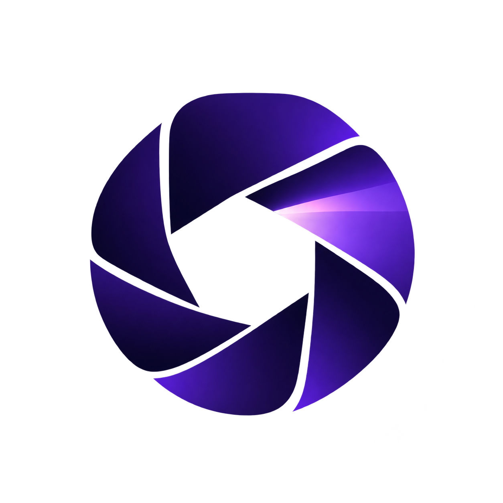

<p align="center">
  
</p>

<h1 align="center">Literoom</h1>

A lightweight, Lightroom-style photo editor written in C++23 on top of [LiteUI](third_party/liteui), a single-header UI library.

Edits are **non-destructive**: your original picture is never changed. Every adjustment is stored as a small list of settings (in a `.literoom.json` file next to the picture) and re-applied on top of the original.

## Features

- **Adjustments:** exposure, contrast, highlights, shadows, white balance, vibrance, saturation, texture, clarity, sharpening, dehaze, noise reduction, Auto Tone and a white-balance picker
- **Looks:** filters, vignette, grain and 3D LUTs (`.cube`)
- **Color:** tone curves, Color Mixer and Color Grading
- **Local edits:** masks (gradients, rectangle, polygon, brush, luminosity, color range and AI object selection), combinable
- **Geometry:** crop, rotate, flip and straighten
- **Workflow:** history, presets, snapshots, virtual copies, copy/paste/sync settings, ratings, flags and color labels, before/after view, histogram, waveform and vectorscope
- **Export:** PNG (8 or 16-bit) and JPEG, with resizing and batch export

AI object selection uses MobileSAM through ONNX Runtime. Without it, a basic color-grow tool is used instead. Everything else works the same.

## Download

Prebuilt packages are on the [Releases](../../releases) page:

| Platform | Package |
|---|---|
| Windows x64 | `literoom-setup-x64.exe` installer, or `literoom-windows-x64.zip` |
| Linux x64 | `.deb` package, or `literoom-linux-x64.tar.gz` |

The Windows build is unsigned, so SmartScreen may show an "unknown publisher" warning.

## Build from source

You need CMake 3.21+, Ninja and a C++23 compiler: **MSVC** (Visual Studio with *Desktop development with C++*) on Windows, or **GCC 14** on Linux.

On Linux, install the libraries LiteUI needs (Wayland is required):

```bash
sudo apt-get install ninja-build pkg-config g++-14 gcc-14 \
  libwayland-dev libcairo2-dev libpango1.0-dev \
  libegl1-mesa-dev libgles2-mesa-dev libxkbcommon-dev \
  libpng-dev libjpeg-dev
```

Then configure, build and run with a preset (on Windows, use a **Developer PowerShell for VS**):

```bash
cmake --preset gcc-release          # Windows: msvc-release
cmake --build --preset gcc-release
./build/release/literoom            # Windows: .\build\release\literoom.exe
```

Other presets: `*-debug`, `*-debug-asan` and `*-release-profile` (see `CMakePresets.json`).

### AI object selection (optional)

1. Download the [ONNX Runtime](https://github.com/microsoft/onnxruntime/releases) release for your platform and unpack it.
2. Download `mobile_sam.encoder.onnx` and `mobile_sam.decoder.onnx` from [`mobile_sam/` on Hugging Face](https://huggingface.co/nrl-ai/samexporter-onnx-models) into `models/`.
3. Configure with ONNX turned on:

```bash
cmake --preset gcc-release -DLITEROOM_ONNX=ON -DONNXRUNTIME_DIR=<unpacked onnxruntime folder>
```

`ONNXRUNTIME_DIR` is the folder that directly contains `include/` and `lib/`. The build copies `models/` next to the executable. To use models from somewhere else, set the `LITEROOM_MODELS` environment variable.

To check it worked, open an image, add an **Object** mask in the Masks pane and look for `Engine: MobileSAM`.

## Tests

```bash
ctest --preset gcc-release          # Windows: msvc-release
```

See [docs/testing.md](docs/testing.md) for the unit tests, the golden render test and sanitizer runs.

## Data locations

| What | Windows | Linux |
|---|---|---|
| Presets | `%APPDATA%\Literoom\presets` | `~/.config/literoom/presets` |
| LUT library | `%APPDATA%\Literoom\luts` | `~/.config/literoom/luts` |

## Documentation

| Page | What it covers |
|---|---|
| [architecture.md](docs/architecture.md) | How the pieces fit together. Start here. |
| [headers.md](docs/headers.md) | Reference for every engine header |
| [app-headers.md](docs/app-headers.md) | Reference for the UI shell (`src/app/`) |
| [threading.md](docs/threading.md) | Background workers and thread-safety rules |
| [undo-and-history.md](docs/undo-and-history.md) | Undo steps and History labels |
| [sidecar-format.md](docs/sidecar-format.md) | The saved-edits file format |
| [extending.md](docs/extending.md) | How to add a slider or a mask type |
| [testing.md](docs/testing.md) | Tests, golden render test, sanitizers |
| [releasing.md](docs/releasing.md) | CI and cutting a release |