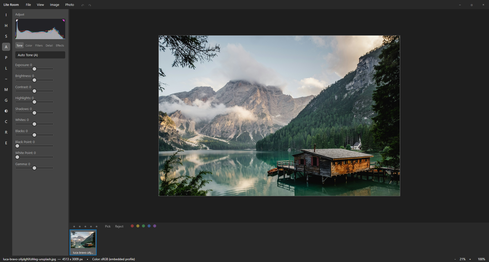
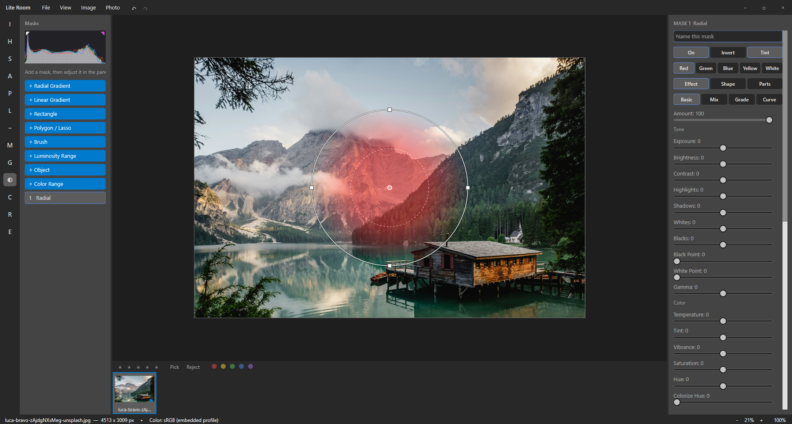
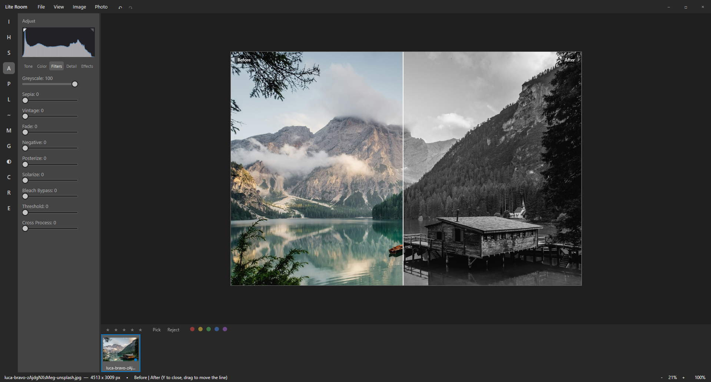
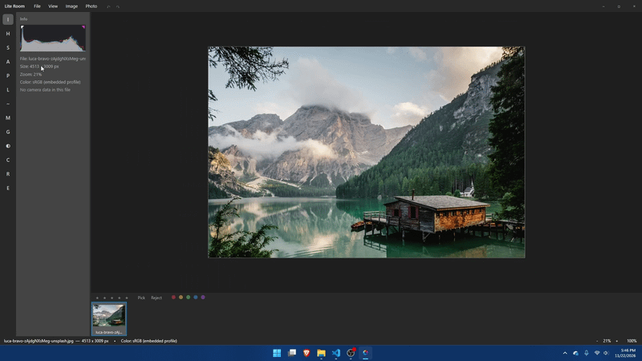

# Literoom

<p align="center">
  
</p>

<h1 align="center">Literoom</h1>

<p align="center">
  <strong>A non-destructive desktop photo editor built with C++23.</strong>
</p>

<p align="center">
  Edit, enhance and color-grade your photographs with powerful adjustment tools, local masks, curves, LUTs and more.
</p>

<p align="center">
  <a href="https://github.com/IAmTheFool/literoom/releases/latest">Download</a> ·
  <a href="#features">Features</a> ·
  <a href="#screenshots">Screenshots</a> ·
  <a href="#building-from-source">Build from source</a>
</p>

---

<p align="center">
  
</p>

## Overview

**Literoom** is an open-source, Lightroom-style desktop photo editor written in C++23 and built on [LiteUI](https://github.com/IAmTheFool/liteui).

It provides a non-destructive editing workflow: your original photographs are never modified by your edits. Adjustments are saved in small `.literoom.json` sidecar files alongside the original image and can be changed at any time.

From basic exposure adjustments to advanced color grading and local masking, Literoom brings a collection of photo-editing tools into a native desktop application.

## Download

**Latest release: [Literoom v0.1.0](https://github.com/IAmTheFool/literoom/releases/latest)**

Prebuilt packages are available for Windows and Linux.

| Platform | Download | Type |
|---|---|---|
| Windows x64 | `literoom-setup-x64.exe` | Installer |
| Windows x64 | `literoom-windows-x64.zip` | Portable archive |
| Linux x64 | `literoom_0.1.0_amd64.deb` | Debian package |
| Linux x64 | `literoom-linux-x64.tar.gz` | Archive |

Visit the [Releases page](https://github.com/IAmTheFool/literoom/releases) for downloads and checksums.

**Windows note:** The installer is currently unsigned. Windows SmartScreen may display an unknown publisher warning.

## Features

### Photo adjustments

A range of controls for shaping the overall appearance of your photographs.

- Exposure
- Contrast
- Highlights and shadows
- White balance
- Vibrance and saturation
- Texture and clarity
- Sharpening
- Dehaze
- Noise reduction
- Auto Tone
- White balance picker

### Color grading

Tools for more detailed control over the colors and tonal character of an image.

- Tone curves
- Color Mixer with eight hue bands
- Color Grading wheels
- 3D LUT support (`.cube`)
- Filters
- Vignette
- Film grain

### Local adjustments and masks

Apply adjustments to selected areas instead of the entire photograph.

- Brush masks
- Linear and radial gradients
- Rectangle and polygon masks
- Luminosity range masks
- Color range masks
- AI object selection
- Combinable mask parts

### Geometry

- Crop
- Rotate
- Flip
- Straighten

### Editing workflow

- Non-destructive editing
- Undo and redo
- Editing history
- Presets
- Snapshots
- Virtual copies
- Copy and paste settings
- Sync settings across photographs
- Ratings, flags and color labels
- Before/after comparison

### Histogram and scopes

Visual tools to help inspect image tones and colors.

- Histogram
- Waveform
- Vectorscope

### Export

- PNG export
- 16-bit PNG export
- JPEG export
- Image resizing
- Batch export

## Screenshots

A closer look at Literoom's editing tools.

### Main editor


### Adjustments



### Tone curves and color grading


### Local masks



### Before and after



## See Literoom in action

A short demonstration of the editing workflow.

[**Watch the Literoom demo video**](docs/media/literoom-demo.mp4)

<!-- Alternatively, replace this with an animated GIF:
<p align="center">
  
</p>
-->

## Supported formats

| Format | Import | Export |
|---|:---:|:---:|
| JPEG | Yes | Yes |
| PNG | Yes | Yes |
| 16-bit PNG | Yes | Yes |
| RAW | No | No |
| TIFF | No | No |

16-bit PNG images can be processed and exported through the 16-bit rendering path.

## AI object selection

Literoom optionally supports AI-powered object selection using **MobileSAM** through ONNX Runtime.

Without ONNX Runtime and the required models, a basic color-grow selection tool is used instead. The rest of the editor works normally.

See the optional AI setup instructions below.

## Non-destructive editing

Literoom does not overwrite your original photograph when you make adjustments.

Instead, editing settings are stored in a `.literoom.json` sidecar file next to the image. When the image is reopened, Literoom loads those settings and applies them again.

This keeps the original image intact while allowing edits to be revisited and changed.

## Building from source

### Requirements

- CMake 3.21 or newer
- Ninja
- C++23 compiler
- MSVC on Windows
- GCC 14 on Linux

On Windows, install Visual Studio with the **Desktop development with C++** workload.

On Linux, install the required dependencies:

```bash
sudo apt-get install ninja-build pkg-config g++-14 gcc-14 \
  libwayland-dev libcairo2-dev libpango1.0-dev \
  libegl1-mesa-dev libgles2-mesa-dev libxkbcommon-dev \
  libpng-dev libjpeg-dev
```

Wayland is required by the Linux build.

### Configure and build

Clone the repository:

```bash
git clone --recursive https://github.com/IAmTheFool/literoom.git
cd literoom
```

Configure:

```bash
cmake --preset gcc-release
```

On Windows, use:

```powershell
cmake --preset msvc-release
```

Build:

```bash
cmake --build --preset gcc-release
```

On Windows:

```powershell
cmake --build --preset msvc-release
```

Run:

```bash
./build/release/literoom
```

On Windows:

```powershell
.\build\release\literoom.exe
```

Other presets include debug, AddressSanitizer and release-profile configurations. See `CMakePresets.json` for the available presets.

### Optional: AI object selection

To enable MobileSAM object selection:

1. Download the appropriate [ONNX Runtime release](https://github.com/microsoft/onnxruntime/releases).
2. Download the MobileSAM encoder and decoder models from [Hugging Face](https://huggingface.co/nrl-ai/samexporter-onnx-models).
3. Place the models in the project's `models/` directory.

Configure the build with ONNX enabled:

```bash
cmake --preset gcc-release \
  -DLITEROOM_ONNX=ON \
  -DONNXRUNTIME_DIR=<unpacked-onnxruntime-folder>
```

`ONNXRUNTIME_DIR` should point to the directory containing `include/` and `lib/`.

To use models from another directory, set the `LITEROOM_MODELS` environment variable.

To verify the integration, open an image, add an Object mask in the Masks pane and look for `Engine: MobileSAM`.

## Running tests

Literoom includes engine unit tests, golden render tests and a LUT pane test.

Run the test suite using:

```bash
ctest --preset gcc-release
```

On Windows:

```powershell
ctest --preset msvc-release
```

For more information, see [docs/testing.md](docs/testing.md).

## User data

Literoom stores presets and LUT libraries in the following locations:

| Data | Windows | Linux |
|---|---|---|
| Presets | `%APPDATA%\Literoom\presets` | `~/.config/literoom/presets` |
| LUT library | `%APPDATA%\Literoom\luts` | `~/.config/literoom/luts` |

## Documentation

For developers interested in the internals:

| Document | Description |
|---|---|
| [Architecture](docs/architecture.md) | Overall architecture and design |
| [Engine headers](docs/headers.md) | Reference for engine headers |
| [App headers](docs/app-headers.md) | UI shell reference |
| [Threading](docs/threading.md) | Background workers and thread-safety |
| [Undo and history](docs/undo-and-history.md) | Undo system and history |
| [Sidecar format](docs/sidecar-format.md) | Saved editing data format |
| [Extending Literoom](docs/extending.md) | Adding controls and mask types |
| [Testing](docs/testing.md) | Tests and golden render testing |
| [Releasing](docs/releasing.md) | Build and release process |

## Technology

- C++23
- LiteUI
- CMake
- Catch2
- ONNX Runtime (optional)

## Contributing

Contributions, bug reports and suggestions are welcome.

If you encounter a problem or have an idea for improving Literoom, please open an issue in the [GitHub issue tracker](https://github.com/IAmTheFool/literoom/issues).

## License

See [LICENSE](LICENSE) for license information.

---

<p align="center">
  **Literoom** — Photo editing, with your original images kept intact.
</p>

<p align="center">
  <a href="https://github.com/IAmTheFool/literoom">GitHub Repository</a> ·
  <a href="https://github.com/IAmTheFool/literoom/releases">Downloads</a> ·
  <a href="https://github.com/IAmTheFool/literoom/issues">Report an Issue</a>
</p>